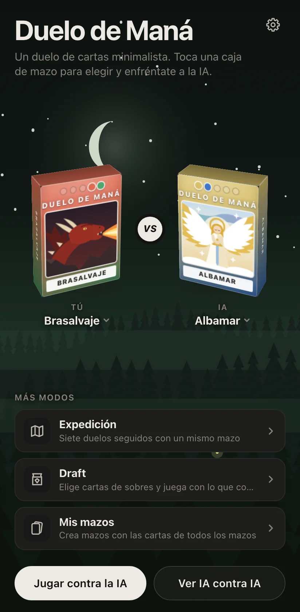
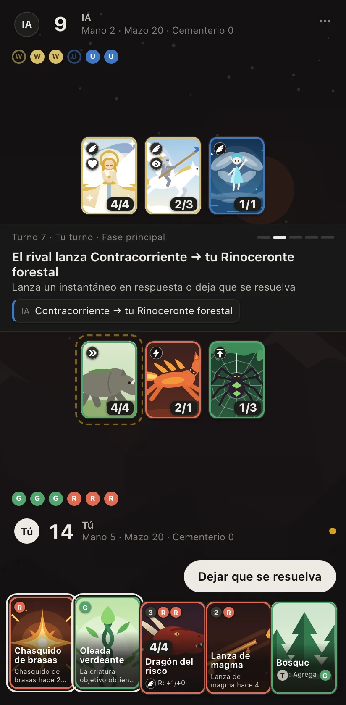
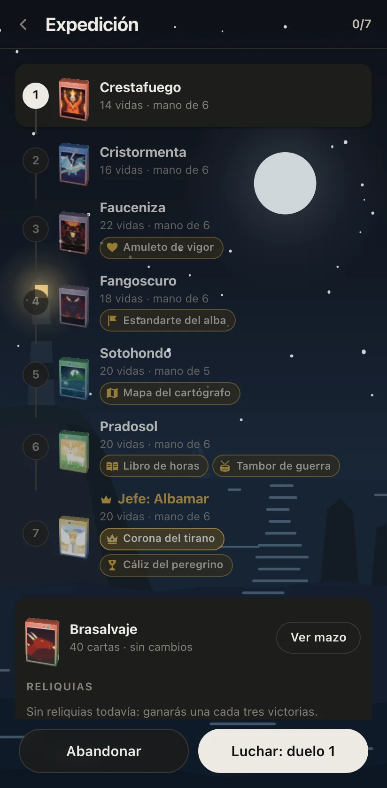

<p align="right"><a href="README.md">English</a> · <b>Español</b></p>

# Duelo de Maná

**Un duelo de cartas minimalista con las reglas de Magic: The Gathering, hecho para el móvil.** Elige uno de catorce
mazos y enfréntate a un rival que juega con las mismas reglas y nunca mira tu mano. Se juega en el navegador: no hay
nada que instalar ni cuentas que crear.

<p align="center"><a href="https://streetclips.github.io/mana-duel/?lang=es"><b>▶ Juega ya en streetclips.github.io/mana-duel</b></a></p>

<p align="center">
  
  
  
</p>

## Qué tiene

- **Magic de verdad, sin el papeleo.** La pila, los instantáneos en respuesta, el mulligan de Londres y el combate con
  vuela, arrolla, toque mortal, dañar primero, vínculo vital, amenaza y una docena de habilidades más. Las tierras
  pagan tus hechizos solas, y la prioridad pasa sola mientras no hay nada que decidir.
- **Catorce mazos, 213 cartas.** Un mazo por cada pareja de colores, negro, rojo y verde por separado, y uno de los
  cinco colores, cada uno con su plan. Cada carta tiene su propia ilustración.
- **Un rival que juega limpio.** La IA del juego sopesa cada jugada jugando la partida hacia delante y nunca ve tu
  mano. O deja que la controle el modelo de lenguaje que elijas a través de [OpenRouter](https://openrouter.ai), con
  tu propia clave: el registro muestra su razonamiento.
- **Más que un duelo.**
  - **Expedición:** siete duelos seguidos con un mismo mazo, contra rivales cada vez más fuertes, con reliquias y un
    jefe al final. Cada victoria te ofrece una carta para tu mazo, cada tres una reliquia, y una sola derrota acaba
    la expedición.
  - **Draft:** pasa sobres con la IA y quédate una carta cada vez, o abre seis sobres en Sellado; luego construye tu
    mazo y juega contra el de la IA al mejor de tres.
  - **Mis mazos:** crea tus propios mazos con todas las cartas del juego, con buscador, filtros y la curva de maná, y
    juégalos en cualquier asiento o en una Expedición.
- **Hecho para una mano.** Toca una carta para jugarla y mantenla pulsada para leerla. También funciona en el
  ordenador.
- **Con vida.** Cada jugada, golpe y muerte se anima; detrás de los menús se suceden cinco paisajes, uno por color de
  maná, de día o de noche; y cada mazo tiene su música, sintetizada al momento, que se vuelve tensa cuando quedan
  pocas vidas.
- **En español y en inglés**, hasta la última palabra, cartas incluidas. Tus expediciones, drafts, mazos y ajustes se
  guardan en tu navegador.

## Los mazos

| Mazo | Colores | Juega con |
| --- | --- | --- |
| Brasalvaje | Rojo, verde | Atacantes rápidos, daño directo, alcance y grandes criaturas que arrollan |
| Albamar | Blanco, azul | Criaturas voladoras, vínculo vital y contrahechizos |
| Fangoscuro | Negro | Toque mortal, eliminación y drenaje de vidas; sus muertos devuelven el golpe |
| Cristormenta | Azul, rojo | Destello, daño directo y robo de cartas; cada instantáneo y cada conjuro potencian a sus criaturas |
| Pradosol | Verde, blanco | Un ejército que crece con contadores +1/+1, refuerzos para todas sus criaturas y ganancia de vidas |
| Forjaluz | Rojo, blanco | Fichas de criatura, dañar primero y prisa; el ejército crece con cada soldado |
| Brumafosa | Azul, negro | Criaturas escurridizas que esquivan a bloqueadoras más grandes y vacían la mano del rival |
| Selvumbra | Negro, verde | Resiliencia, sacrificio y toque mortal; cada muerte alimenta la selva |
| Vesperia | Blanco, negro | Vínculo vital y drenaje de vidas; cada vida que gana fortalece a sus fieles |
| Fauceniza | Negro, rojo | Prisa, amenaza y daño directo; en cuanto el rival sangra, sus criaturas llegan más grandes |
| Sotohondo | Verde, azul | Criaturas que evolucionan y gigantes con antimaleficio que ignoran los hechizos del rival |
| Crestafuego | Rojo | Monjes con destreza que golpean primero y dos veces |
| Tierrabrava | Verde | Cada tierra que entra despierta a sus bestias |
| Encrucijada | Los cinco | Tierras que dan maná de tres colores o de cualquiera, y hechizos multicolores con lo mejor de cada color |

Todas las cartas, tal como las muestra el juego: [`docs/CARDS.md`](docs/CARDS.md).

## Cómo se juega

1. Toca una caja de mazo para elegir tu mazo o el de la IA, o deja cualquiera de los dos al azar, y luego **Jugar
   contra la IA**. Los dos empezáis con 20 vidas y 40 cartas.
2. Juega una tierra por turno. Toca una carta para ver qué puedes hacer con ella: jugarla, lanzarla, activarla.
3. Para atacar, toca **Al combate**, luego tus criaturas y luego **Atacar**. Para bloquear, toca tu criatura y luego
   el atacante al que debe frenar.
4. Cuando un hechizo necesita un objetivo, los objetivos brillan: toca uno.
5. Deja al rival a 0 vidas para ganar. El engranaje de la pantalla de inicio guarda el idioma, el sonido, quién
   controla la IA y las reglas completas en **Cómo se juega**.

**Ver IA contra IA** deja que la IA juegue en los dos asientos. Algunos enlaces para probar: `?theme=light`,
`?fx=slow` (animaciones a cámara lenta), `?deck=gloamwood&aiDeck=crossroads`.

## Ejecútalo tú

```sh
npm install
npm run dev     # http://localhost:5173, también en tu móvil con la dirección de tu red local
npm run build   # la web estática en dist/, que sirve npm run preview
```

Cada push a `main` despliega la web en GitHub Pages con `.github/workflows/pages.yml`. Para jugar contra el LLM en
desarrollo sin escribir una clave, pon `OPENROUTER_API_KEY` en `.env.local`: el servidor de desarrollo la añade a cada
llamada.

## Por dentro

TypeScript, Preact y Vite, con tests en Vitest y Playwright. El motor de reglas son funciones puras sobre un estado de
partida serializable y con semilla, así que cualquier partida se repite exacta a partir de su semilla y sus acciones.
La IA solo lee el estado público, y un test demuestra que tus cartas ocultas nunca cambian sus decisiones. La música y
los sonidos se sintetizan con la Web Audio API. Con el juego abierto, `manaDuel.help()` en la consola lista una API
para manejarlo, y `manaDuel.runChecks()` ejecuta sus comprobaciones de funcionalidades.

| Comando | Qué hace |
| --- | --- |
| `npm run verify` | Formato, lint, Knip, tipos, tests unitarios, 196 partidas IA contra IA y la build, de una vez |
| `npm test` | Tests unitarios del motor, la IA, el jugador LLM, el controlador, la interfaz y el audio |
| `npm run test:e2e` | Playwright sobre la build de producción, en dos móviles y un ordenador |
| `npm run sim -- --games 3000` | Partidas IA contra IA en los 196 emparejamientos, con invariantes y porcentaje de victorias por mazo |
| `npm run test:live` | Llamadas reales a OpenRouter (necesita `OPENROUTER_API_KEY` y gasta créditos) |

La documentación técnica está en inglés: [`AGENTS.md`](AGENTS.md), la guía del código para personas y agentes de
programación, y en `docs/`: [reglas](docs/RULES.md), [modos de juego](docs/MODES.md),
[rival LLM](docs/LLM.md), [audio](docs/AUDIO.md) y [verificación](docs/VERIFICATION.md).

---

Duelo de Maná es un proyecto independiente de fans inspirado en Magic: The Gathering, marca registrada de Wizards of
the Coast. Los nombres y textos de las cartas son originales.
