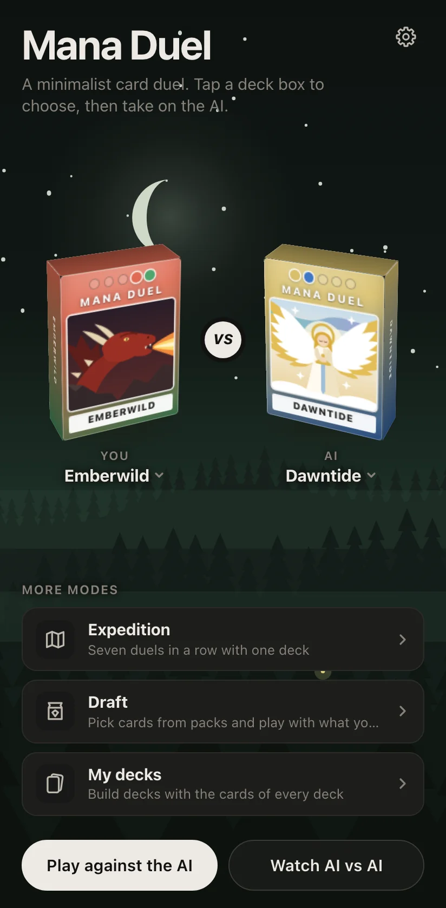
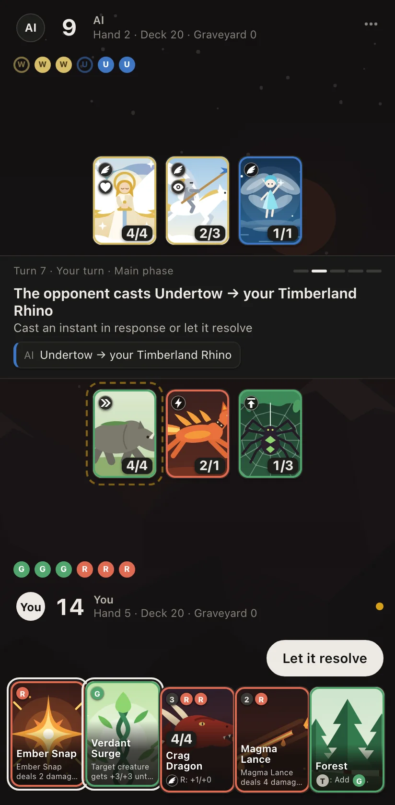
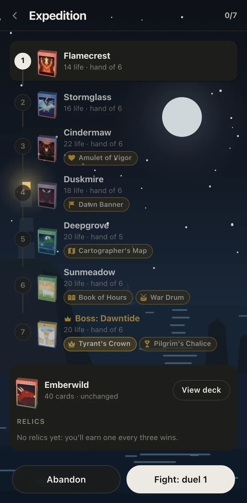

<p align="right"><b>English</b> · <a href="README.es.md">Español</a></p>

# Mana Duel

**A minimalist card duel on the rules of Magic: The Gathering, made for your phone.** Pick one of fourteen decks and
face an opponent that plays by the same rules and never looks at your hand. It runs in the browser, with no account,
and installs on your home screen as an app that also plays offline.

<p align="center"><a href="https://streetclips.github.io/mana-duel/"><b>▶ Play now at streetclips.github.io/mana-duel</b></a></p>

<p align="center">
  
  
  
</p>

## What you get

- **Real Magic, without the busywork.** The stack, instants in response, the London mulligan, and combat with flying,
  trample, deathtouch, first strike, lifelink, menace and a dozen more keywords. Lands pay for your spells on their
  own, and priority passes by itself while there is nothing to decide.
- **Fourteen decks, 213 cards.** One deck per pair of colors, black, red and green alone, and one of all five colors,
  each with its own plan. Every card has its own illustration.
- **An opponent that plays fair.** The built-in AI weighs each move by playing the game forward and never sees your
  hand. Or let a language model of your choice play it through [OpenRouter](https://openrouter.ai), with your
  own key: the log shows its reasoning.
- **More than one duel.**
  - **Expedition:** seven duels in a row with one deck, against rivals that grow stronger, carry relics and end in a
    boss. Each win offers a card for your deck, every third one a relic, and a single defeat ends the run.
  - **Draft:** pass packs with the AI and pick a card each time, or open six packs in Sealed, then build a deck and
    play the AI's at the best of three.
  - **My decks:** build your own decks from every card in the game, with search, filters and the mana curve, and
    play them in any seat or on an Expedition.
- **Made for one hand.** Tap a card to play it, long-press to read it. It works on a desktop too.
- **Alive.** Every play, hit and death is animated; five landscapes, one per color of mana, change behind the menus,
  by day or by night; each deck plays its own music, synthesized live, that turns tense when life runs low.
- **In English and Spanish**, every word of it, cards included. Your runs, drafts, decks and settings stay in your
  browser.

## The decks

| Deck | Colors | Plays with |
| --- | --- | --- |
| Emberwild | Red, green | Fast attackers, direct damage, reach, and big creatures that trample |
| Dawntide | White, blue | Flying creatures, lifelink, and counterspells |
| Duskmire | Black | Deathtouch, removal, and life drain; its dead strike back |
| Stormglass | Blue, red | Flash, direct damage, and card draw; every instant and sorcery powers up its creatures |
| Sunmeadow | Green, white | An army that grows with +1/+1 counters, boosts for all its creatures, and life gain |
| Brightforge | Red, white | Creature tokens, first strike, and haste; the army grows with every soldier |
| Mistgrave | Blue, black | Skulking creatures that slip past bigger blockers and empty the opponent's hand |
| Gloamwood | Black, green | Undying, sacrifice, and deathtouch; every death feeds the jungle |
| Vesperhall | White, black | Lifelink and life drain; every life it gains strengthens its faithful |
| Cindermaw | Black, red | Haste, menace, and direct damage; once the opponent bleeds, its creatures arrive bigger |
| Deepgrove | Green, blue | Creatures that evolve, and hexproof giants that ignore the opponent's spells |
| Flamecrest | Red | Monks with prowess that strike first and twice |
| Wildland | Green | Every land that enters awakens its beasts |
| Crossroads | All five | Lands that tap for three colors or any, and multicolored spells with the best of each |

Every card, in the game's words: [`docs/CARDS.en.md`](docs/CARDS.en.md).

## How to play

1. Tap a deck box to choose your deck or the AI's, or leave either to chance, then **Play against the AI**. You both
   start at 20 life with 40 cards.
2. Play one land a turn. Tap a card to see what you can do with it: play it, cast it, activate it.
3. To attack, tap **To combat**, then your creatures, then **Attack**. To block, tap your creature, then the attacker
   it should stop.
4. When a spell needs a target, the targets glow: tap one.
5. Bring the opponent to 0 life to win. The gear on the start screen holds the language, the sound, who plays the AI
   and the full rules under **How to play**.

**Watch AI vs AI** lets the AI play both seats. A few links to try: `?theme=light`, `?fx=slow` (animations in slow
motion), `?deck=gloamwood&aiDeck=crossroads`.

## Run it yourself

```sh
npm install
npm run dev     # http://localhost:5173, on your phone too through your LAN address
npm run build   # the static site in dist/, served by npm run preview
```

Every push to `main` deploys the site to GitHub Pages through `.github/workflows/pages.yml`. To play the LLM opponent
in development without typing a key, set `OPENROUTER_API_KEY` in `.env.local`: the dev server adds it to each call.

## Under the hood

TypeScript, Preact and Vite, tested with Vitest and Playwright. The rules engine is pure functions over a seeded,
serializable game state, so any game replays exactly from its seed and its actions. The AI reads only public state, and
a test proves your hidden cards never change its decisions. The music and sounds are synthesized with the Web Audio
API. With the game open, `manaDuel.help()` in the console lists an API to drive it, and `manaDuel.runChecks()` runs
its built-in feature checks.

| Command | What it does |
| --- | --- |
| `npm run verify` | Format check, lint, Knip, typecheck, unit tests, 196 AI-vs-AI games and the build, in one go |
| `npm test` | Unit tests of the engine, AI, LLM player, controller, UI and audio |
| `npm run test:e2e` | Playwright on the production build, on two phones and a desktop |
| `npm run sim -- --games 3000` | AI-vs-AI games in all 196 matchups, with invariant checks and win rates per deck |
| `npm run test:live` | Real OpenRouter calls (needs `OPENROUTER_API_KEY` and spends credits) |

Read on in [`AGENTS.md`](AGENTS.md), the guide to the code for people and coding agents, and in `docs/`:
[rules](docs/RULES.md), [game modes](docs/MODES.md), [LLM opponent](docs/LLM.md), [audio](docs/AUDIO.md) and
[verification](docs/VERIFICATION.md).

---

Mana Duel is an independent fan project inspired by Magic: The Gathering, a trademark of Wizards of the Coast. Card
names and texts are original.
